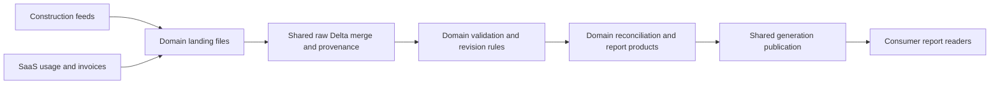

# Platform architecture and report contract

All example feeds and outputs are synthetic. Both examples use the shared mechanics in `src/enterprise_data_platform/core.py`. Each domain declares its own feeds and reconciliation rules. The construction run reads only six named source prefixes from `landing/`; expected answers and scenario manifests remain outside that prefix.

In the construction example, bronze stores what arrived, including source file hashes and ingestion batches. Silver holds revision history, current validated records, delivery status, reconciliation, and quarantine. The SaaS example stores raw usage and invoice revisions in bronze and derives current records during each run. Both examples write gold products beneath a unique generation directory. Readers resolve products through `current_generation.json` and must not read staged generation directories directly. The local pointer is atomically replaced only after reporting writes succeed. Databricks object-store behavior remains unverified.

## Consumer queries

For the local CLI use `.venv/bin/python -m enterprise_data_platform.cli report --root <root>` to resolve the active generation and print a synthetic report. The Delta products are also readable through PySpark using paths under `tables/gold/generations/<generation>/`. Workspace SQL registration and dashboard execution are not configured. Keep a single generation ID across all products in a consumer query. `scripts/render-report.py` exports the actual latest run report as a self-contained synthetic HTML report; it does not query Delta independently or claim live freshness.

Construction daily quantity grain: project, material, project-local receipt date; measure: accepted net metric tonnes. Construction invoice exception grain: invoice line; exception rows carry the source invoice, PO, allocation, and delivery evidence. Net invoice amount grain: company, supplier, currency; credits use positive source amounts and signed negative reporting values. The SaaS reconciliation grain is customer and billing period for the single-invoice example. No product initiates payments.
